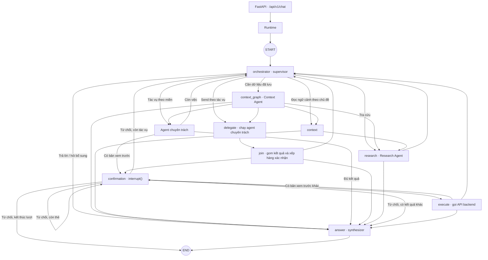

# HercFit Agentic

FastAPI nhận yêu cầu tại `/api/v1/chat` và `/api/v1/chat/stream`. `Runtime` quản lý phiên, checkpoint, streaming và
xác nhận. LangGraph phân phối công việc cho các agent dựa trên quyết định của supervisor.

## Cấu trúc thư mục

```text
agentic/
├── core/                   FastAPI, schema HTTP và ngữ cảnh request
│   └── app/
├── agents/                 Agent, bộ thực thi dùng chung và danh sách agent
│   ├── orchestration_agent.py  Supervisor và synthesizer
│   ├── specialists.py         Agent chuyên trách theo miền
│   ├── research_agent.py      Agent tra cứu và kiểm chứng nguồn
│   ├── tool_agent.py          Đọc, xem trước và thực thi tool
│   └── roster.py              Ánh xạ agent, miền và vai trò model
├── orchestrators/
│   ├── langgraph.py        Đồ thị chat và luồng xác nhận
│   └── runtime.py          Vòng đời lượt chạy và phiên chat
├── workflows/              Các bước và chính sách dùng trong đồ thị chat
│   ├── state.py            State chung và quyết định định tuyến
│   ├── route_rules.py      Luật định tuyến của supervisor
│   ├── delegation.py       Tách nhiệm vụ và gom kết quả
│   └── specialist_graph.py  Đồ thị con của agent chuyên trách
├── configs/                Thiết lập tiến trình, nguồn biến môi trường và đường dẫn
├── memory/                 Checkpoint, transcript, bộ nhớ phiên và xoá dữ liệu
├── tools/                  Registry, schema và chính sách gọi tool
├── services/               Nghiệp vụ hỗ trợ, model, adapter và client dịch vụ ngoài
├── research/               Truy hồi, xếp hạng và kiểm chứng bằng chứng
├── embedding/              Embedding, tìm kiếm tài liệu và ingestion
├── knowledge_graph/        Mô hình cá nhân trên Neo4j, Context Graph và worker đồng bộ
├── prompts/                Registry và nội dung prompt theo phiên bản
├── security/               Kiểm tra đầu vào và xác thực đầu ra
├── observability/          Trace, log, số đo và cảnh báo
├── migrations/             SQL cho kho dữ liệu của Agentic
└── scripts/                CLI migration, kiểm tra cấu hình và bảo trì
```

## Các agent

Supervisor áp dụng luật định tuyến trong `workflows/route_rules.py` và có thể gọi Jev hoặc model để chọn bước tiếp
theo. Với lệnh dùng tool, supervisor giao cho agent sở hữu miền. Các agent chuyên trách dùng chung `ToolAgent` và có
thể áp dụng luật riêng để tiếp tục tác vụ nhiều bước. `AGENT_MODELS` cho phép chọn model theo agent.

| Agent chuyên trách | Miền phụ trách |
|---|---|
| `nutrition` | Bữa ăn và thực phẩm |
| `training_log` | Buổi tập đã thực hiện và bài tập |
| `body_health` | Số đo cơ thể, tiến độ và hồ sơ |
| `coach` | Lịch tập, mục tiêu và tư vấn huấn luyện |
| `daily_health` | Đọc dữ liệu thiết bị và đánh giá sức khoẻ hằng ngày do backend tính |

Research Agent điều hành đồ thị con lập kế hoạch, thu thập, tổng hợp và xác thực nguồn. Context Agent dùng truy vấn
mẫu hoặc sinh Cypher chỉ đọc để lấy dữ kiện phục vụ câu hỏi. Synthesizer soạn câu trả lời từ kết quả đã có.
`clarify` và `memory` có vai trò model riêng, còn `notifier` soạn thông báo qua API nội bộ.

## Luồng LangGraph



Khi thao tác ghi cần xác nhận, LangGraph lưu checkpoint và gửi bản xem trước cho người dùng.
`POST /api/v1/chat/confirm` tiếp tục từ checkpoint đó. Nhánh duyệt dùng `action_id` làm khoá idempotency khi gọi API
nghiệp vụ. Với tác vụ song song, mỗi nhánh chạy trên state riêng rồi `join` gom kết quả và xếp hàng các thẻ xác nhận.

## Entry point

Các lệnh sau chạy từ thư mục `backend/`. Hướng dẫn biến môi trường và Docker Compose nằm trong [README dự án](../../README.md).

| Thành phần | Lệnh |
|---|---|
| FastAPI | `python -m uvicorn agentic.core.app.main:app --port 8081` |
| Migration Agentic | `python -m agentic.scripts.migrate` |
| Worker Knowledge Graph | `python -m agentic.knowledge_graph.worker run` |
| Worker ingestion | `python -m agentic.embedding.ingestion.cli worker` |
