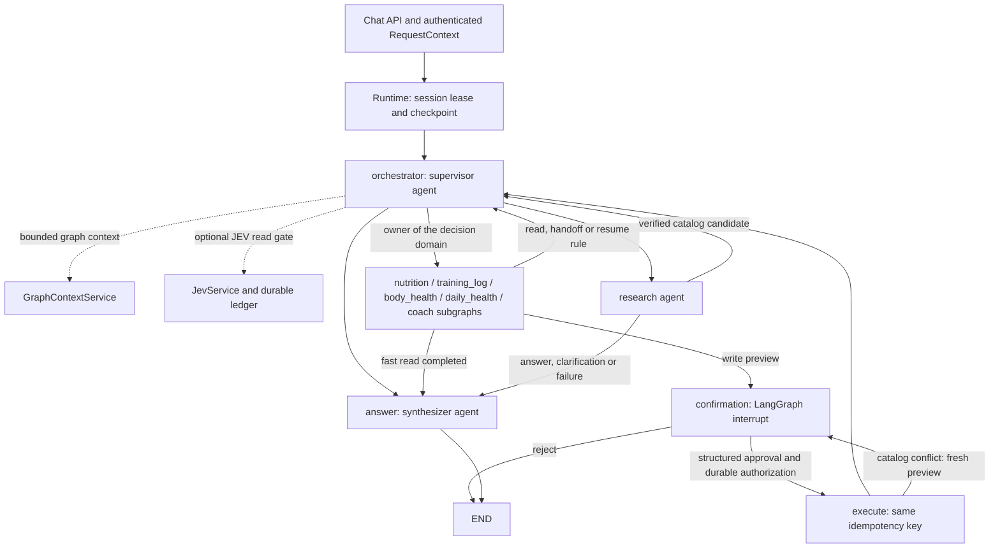
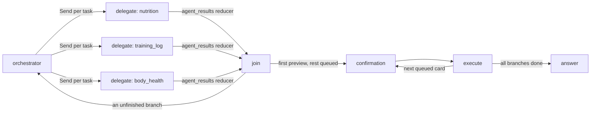

# Architecture

## Directory structure and ownership

```text
agentic/
├── core/
│   ├── app/
│   │   ├── main.py              # FastAPI composition and lifespan
│   │   ├── config.py            # AgentSettings; original environment precedence
│   │   ├── env_sources.py
│   │   ├── dependencies.py      # Authentication and request-scoped context
│   │   ├── schemas/             # Chat, confirmation and response contracts
│   │   └── api/v1/chat_router.py # Same chat, SSE, history and graph endpoints
│   ├── context.py               # Credentials outside persisted graph state
│   ├── paths.py                 # Stable backend/package resource roots
│   ├── roster.py                # Agent names, owned domains, running-agent context
│   ├── llm.py                   # Role/agent model factory, fallback and escalation
│   └── providers/fpt.py         # Existing provider/DSML compatibility
├── components/
│   ├── hybrid_retriever.py      # Adapter to backend approved-document search
│   ├── reranker.py              # Existing relevance/topic/publisher ranking
│   └── context_filter.py        # Bounded passages, graph context, deduped evidence
├── services/
│   ├── runtime.py               # Sessions, streaming, confirmation and recovery
│   ├── rag_pipeline.py          # Bounded, authenticated graph retrieval stage
│   ├── routing.py               # Deterministic fast-read templates/verification
│   ├── jev.py                   # Durable decision ledger, cache and budgets
│   ├── research_budget.py
│   ├── catalog_choice.py        # Catalog choices and signed finalization
│   ├── clarification.py         # Card frames (choice, number, sets); no free-text answers
│   ├── write_reply.py           # Code-owned summary of confirmed writes, repeat guard
│   ├── delegation.py            # Parallel fan-out plan, branch state, join, card queue
│   ├── failure_reply.py         # Code-owned reply of a failed turn
│   ├── food_suggestion.py
│   ├── illustrations.py
│   └── memory/
│       ├── store.py             # PostgreSQL sessions/actions/usage
│       ├── checkpoints.py       # Pool and LangGraph checkpointer lifecycle
│       ├── session_memory.py    # Optional Redis tier and rolling summaries
│       ├── transcript.py
│       ├── turns.py
│       └── reconcile.py
├── prompts/
│   ├── registry.py              # Explicit version lookup; isolated JEV questions
│   ├── layout.py                # Static instructions vs history/runtime evidence
│   └── v1/                     # Router, answer, tool, research, memory, domain prompts
├── agents/
│   ├── state.py                 # One AgentState and RouteDecision contract
│   ├── workflow.py              # Main LangGraph nodes, specialist subgraphs, handoffs
│   ├── adaptive_router.py       # Conservative JEV standalone-read gate
│   ├── orchestration_agent.py   # Supervisor (routing) and synthesizer (answer)
│   ├── specialists.py           # Nutrition, TrainingLog, BodyHealth, DailyHealth, Coach agents
│   ├── tool_agent.py            # Shared tool executor: allowlists, previews, HITL execute
│   └── research_agent.py        # Existing ResearchV2 bounded subgraph
├── tools/
│   ├── registry.py              # Allowlisted backend endpoints, unchanged names
│   ├── definitions/base.py      # ToolSpec; declaration cannot execute a tool
│   ├── schemas/common.py        # Tool-only wrappers, reusing backend schemas
│   ├── policy.py                # Domain/read-only allowlists and handoffs
│   ├── output.py                # Existing output bounds and catalog query limits
│   └── integrations/            # BackendClient, TavilyClient, JevClient
├── security/
│   ├── input_guard.py           # Public research query privacy and clinical guards
│   ├── content_filter.py        # Existing deterministic safety policy
│   └── output_validation.py     # Draft parsing, real quotes and supported numbers
├── observability/
│   ├── execution.py             # Node guard, latency, errors, token/cost accounting
│   ├── telemetry.py             # Model callbacks and JEV metric aggregation
│   └── tracing.py               # Existing graph tracing bridge
├── evaluation/
│   ├── datasets/               # Unchanged KG, memory and JEV JSONL golden sets
│   ├── kg_eval.py              # Retrieval and end-to-end quality/latency
│   ├── memory_eval.py
│   ├── jev_eval.py              # Routing, review and cost reports
│   ├── jev_shadow_gates.py
│   ├── jev_shadow_workflow.py
│   ├── agent_model_eval.py     # Agent × model matrix on each agent's real code path
│   └── system_benchmark.py     # Parallel vs sequential, load and provider throughput
├── migrations/                 # Original SQL and migration runner
├── scripts/                    # migrate, maintenance, jev_preflight
├── tests/                      # unit/, integration/, workflows/, fixtures/
├── docs/
├── AGENTS.md
├── pytest.ini
├── Dockerfile
└── docker-compose.yml
```

The tree shows the current code. Historical `main`, `runtime`, `api`, `config`,
`schemas`, `clients`, `graph`, `memory`, selected `core` modules and evaluation
wrappers have been removed after migrating repository consumers. Only canonical
module paths are supported. HTTP contracts and persisted workflow state remain
unchanged.

## Source-to-target mapping

| Existing location | Canonical location | Preserved behavior |
| --- | --- | --- |
| `main.py`, `api/`, `config/`, `schemas/` | `core/app/` | HTTP API, SSE, auth, settings |
| `runtime.py`, `memory/`, `graph/checkpoints.py` | `services/runtime.py`, `services/memory/` | Sessions, Redis fallback, actions, recovery |
| `graph/workflow.py`, `core/state.py` | `agents/workflow.py`, `agents/state.py` | Reducers, checkpoints (node names: see Workflow) |
| `agents/research_v2.py` | `agents/research_agent.py` | ResearchV2 class and bounded research graph |
| `core/knowledge_helpers.py` | `services/routing.py` + `components/context_filter.py` | Strict fast reads and grounded context |
| Nested workflow retrieval | `services/rag_pipeline.py` | 150 ms cap, owner check, fail-open KG |
| Research source ranking / context construction | `components/` | Ordering, limits, exact verified passages |
| `core/jev.py`, catalog/form/suggestion helpers | `services/` | Existing decisions and durable budgets |
| Embedded agent/memory prompts, `core/prompting.py` | `prompts/v1/`, `registry.py`, `layout.py` | Exact original prompt text |
| `core/tool_policy.py`, `core/tool_output.py` | `tools/policy.py`, `tools/output.py` | Allowlists, handoffs, output limits |
| `clients/` | `tools/integrations/`, `core/providers/` | HTTP contracts and provider behavior |
| `core/safety.py`, research query/claim guards | `security/` | Same blocking/verification rules |
| `core/telemetry.py`, tracing, workflow node guard | `observability/` | Usage/cost and safe error handling |
| `tests/evaluation/` | `evaluation/` | Frozen cases; canonical CLI entrypoints |
| Root maintenance commands | `scripts/` | Same operations and arguments |

[module-map.json](module-map.json) records the migration from deleted legacy files
to their canonical replacements. It is historical documentation, not an alias registry.

## Dependency boundaries

`core/app/main.py` is the composition root. It constructs or accepts dependencies,
enters persistence, builds the graph and owns shutdown. `AsyncExitStack` closes
already acquired resources if model, persistence or graph startup fails. Shutdown
cancels background tasks before closing their dependencies. Injected clients are
closed by the app, matching the previous client ownership contract.

Agents coordinate services, tools and components. Services may share `agents.state`
as a data contract but do not import agent implementations. Components provide
retrieval/filtering primitives; prompts contain application-owned instructions.
Backend schemas remain canonical, including those used for tool validation.
No service locator, DI framework or second backend data layer was introduced.

## Workflow and confirmation



Main node names are `orchestrator`, `nutrition`, `training_log`, `body_health`,
`daily_health`, `coach`, `delegate`, `join`, `context`, `research`, `confirmation`, `execute` and `answer`. Research keeps
`research_plan`, `research_gather`, `research_synthesize`, `research_validate`.
State keys and `add_messages` are unchanged. Nodes return partial state updates.
Existing catalog/research handoff fields remain the only handoff protocol;
credentials never enter state.

## Specialist agents and per-agent models

The supervisor (`OrchestrationAgent.decide`) makes one routing decision per step
and keeps the code-owned routing rules (safety, handoffs, `write_done`, Jev,
personalization, Plan mode). It hands a `tool` decision to the specialist that owns
its domain (`core/roster.py`):

| Agent | Domains | Owned behavior |
| --- | --- | --- |
| `nutrition` | `meals`, `foods` | Meal fast path, food-suggestion lookup, `meal_log_next` |
| `training_log` | `trainings`, `exercises` | Gym mode form (`gym_mode_guard`), `gym_mode_*` replies |
| `body_health` | `metrics`, `progress`, `profile` | Body measurements (writes), progress, profile |
| `daily_health` | `health` | Read-only Daily Health Intelligence: device data and `get_health_assessment` |
| `coach` | `training_plans`, `goals`, `coaching` | `plan_build_tool` after Plan-mode research |

Each specialist is a compiled subgraph (`act`, looping while a catalog lookup feeds
the journal write) that subclasses ToolAgent, so allowlists, previews, budgets and
the durable confirmation path are shared. Subgraphs compile with
`checkpointer=False`: they never interrupt, so only the main graph persists state. A specialist's `resume` rule continues its
own multi-step task without another router call; supervisor evaluates them before
`write_done`. The route trace records each hand-off as `{'stage': 'agent', ...}`
and turn records list them under `route.agents`.

`AGENT_MODELS` (JSON, keys from `roster.AGENTS`: `supervisor`, the five
specialists, `research`, `synthesizer`, `clarify`, `memory`) assigns a model per
agent. The running agent is a context variable set per node, so `Models.get(role)`
keeps its signature. An agent model is tried once (no retries, timeout capped by
`AGENT_MODEL_TIMEOUT_SECONDS`) and escalates to the role model on error, timeout or
empty structured output; a tool step that writes a
text preview instead of a write call retries on the role model. Telemetry keeps
`telemetry.agents[agent]` (calls, tokens, model time, models that actually
answered) and prices each call by the model that answered.

### Daily Health Intelligence

`daily_health` owns the read-only `health` domain. Numbers never come from the model:
the backend engine (`backend/domains/analytics/services/daily_health/`) builds the day's
snapshot against the user's own 28-day median/MAD baseline (HRV on a log scale), 7-day
trends, training load and a versioned rule-based readiness state (`readiness-heuristic-v1`:
`ready`, `steady`, `ease_off`, `recover`, `needs_review`, `insufficient_data`) with numeric
reasons and a confidence. It is served at `GET /api/v2/health/daily-assessment` and read by
the tool `get_health_assessment` (device consent applies). Questions about today
(`health.readiness` fast template), the `recovery`/`wellbeing` deep reads and
`health.guidance` v5 start from it. `security/content_filter.py` adds a
`red_flag_symptom` caution (chest pain, fainting, severe breathlessness, irregular
heartbeat) that puts safety advice first. Manual sleep (bedtime and wake time the user reports) is a
write-through `log_sleep` in the `metrics` domain, so `body_health` owns it behind the
confirmation card and `health` stays read-only. Morning briefings and the in-app inbox live in
the backend (`domains/notifications`, code-composed, no LLM). Design and evaluation:
`docs/design/daily-health-intelligence-agent.md`.

### Parallel delegation

A message with 2–3 independent parts in different agents' domains (log a meal, log a
workout, read body data) is decomposed by the router in `RouteDecision.tasks` (field
descriptions only; prompts unchanged). `services/delegation.py` decides whether to
fan out: first decision of the turn, router action `tool`, not personalized/QA/form/
safety, every domain allowed by the chat mode, one task per distinct specialist, and
no specialist needing a form first (`preflight`). `PARALLEL_AGENTS=false` disables it.



Each branch runs its specialist subgraph on a private copy of the state (fresh tool
outputs, trace and telemetry), so branches never write the same state key in one
superstep; `agent_results` (reducer `collect_results`) carries each branch's new
messages, outputs, records, previews and telemetry to `join`. Join merges them in task
order, shows the first preview and queues the rest in `pending_queue`; each card is
confirmed or rejected on its own (`after_reject` marks the output `rejected` and shows
the next card). When every branch finished, the turn answers after the cards
(`decision.reads` keeps read results in the synthesizer's answer); a branch that needs
input, a catalog/web handoff or a following meal is continued sequentially through the
router, with `writes_before=None` so `write_done` cannot end the turn early.
`telemetry.parallel` records wall time (longest branch) and the sum of branch times.

Checkpoint compatibility: the former `tool` node is gone. Runtime only resumes a
thread at the `confirmation` interrupt or by re-running `execute`, and both names are
unchanged, so pending confirmations survive the rename. A checkpoint stopped
mid-run before `tool` is never resumed (a new turn starts a new thread).

## RAG, caching and security boundaries

Document retrieval remains behind `POST /api/knowledge/search`, implemented in
`backend/agentic/embedding/retrieval/search.py`: approved revisions, visibility filtering,
pgvector distance, PostgreSQL full-text ranking and reciprocal-rank fusion. This
is hybrid retrieval, **not BM25**. The agent adapter consumes that same contract.
Research ranks public sources using existing lexical/topic relevance and source
authority, caps evidence, verifies quotes/numbers and preserves one bounded web
fallback. It introduces no additional LLM or web calls.

The existing caches are Tavily exact-query caching, JEV exact-fingerprint reuse
and optional Redis conversation memory. There is no semantic response cache.
Query planning still uses the existing research plan and router; no standalone
query-rewriting service has been invented. These capabilities can be introduced
later behind these boundaries with separate quality/privacy evaluations.

Security reuses input schemas, domain/read-only allowlists, public-query guards,
clinical safety rules, quote/numeric verification, and the prompt layout that
marks retrieved material as untrusted data. This organization does not claim a
new general prompt-injection detector. Signed research finalization and backend
validation remain authoritative; JEV cannot grant tool or write permissions.

## Observability and evaluation

`agentic/observability` owns per-node guards and metrics as well as the shared
Langfuse exporter, propagation, redaction and operational configuration
(merged from the former `backend/observability` package). Do not instantiate a competing collector.
Unknown usage/cost remains unknown rather than reported as zero.

Evaluation runners now share versioned JEV questions through the registry instead
of parsing agent source files. Golden datasets are byte-for-byte unchanged.
Live evaluations remain opt-in commands against configured services; unit and
workflow tests use synthetic dependencies. See [deployment.md](deployment.md) for
commands and the scope of validation.
