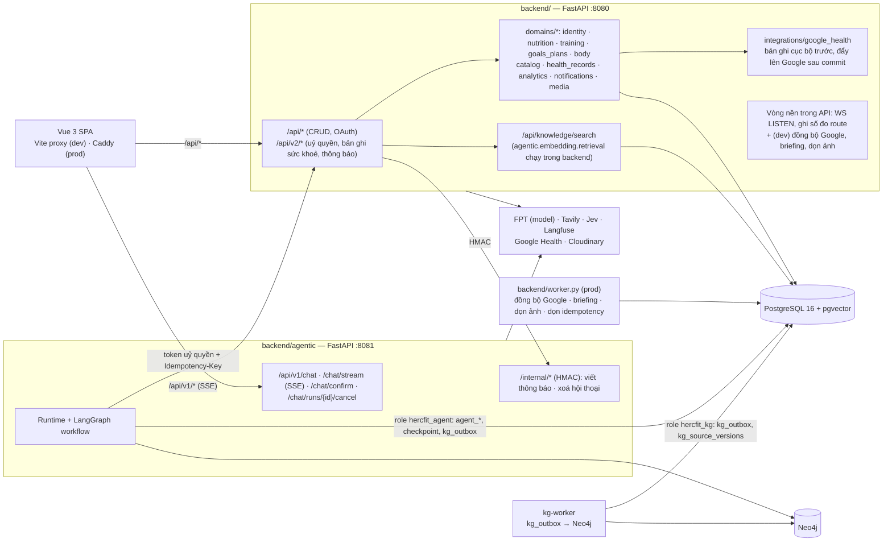
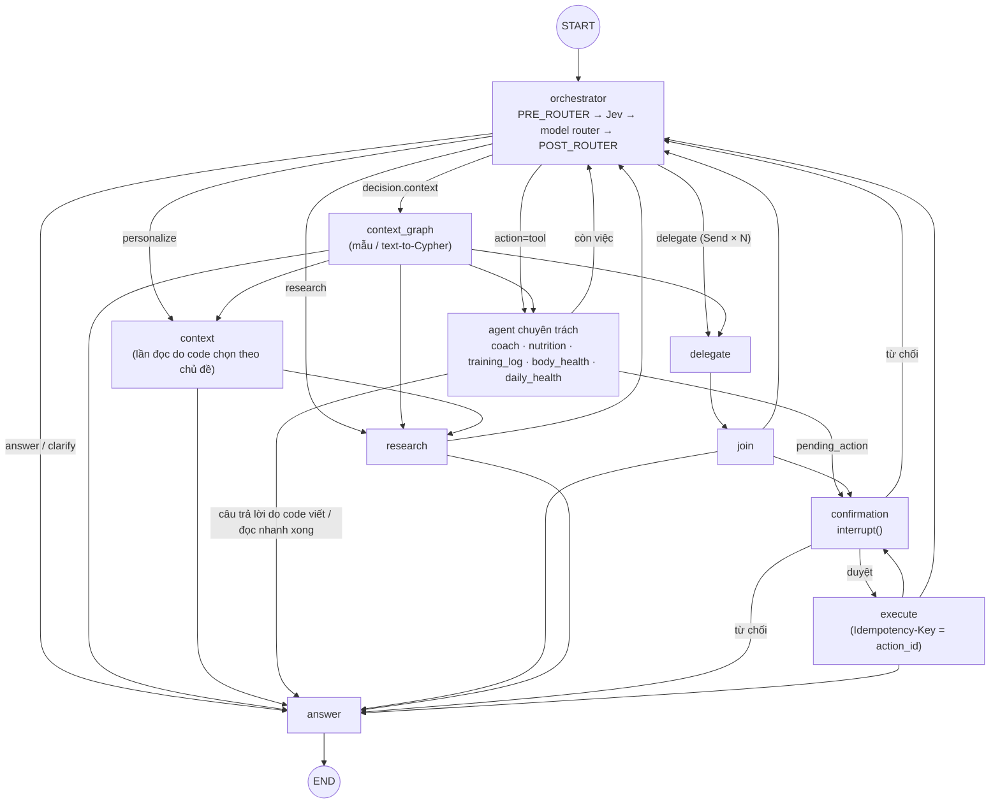
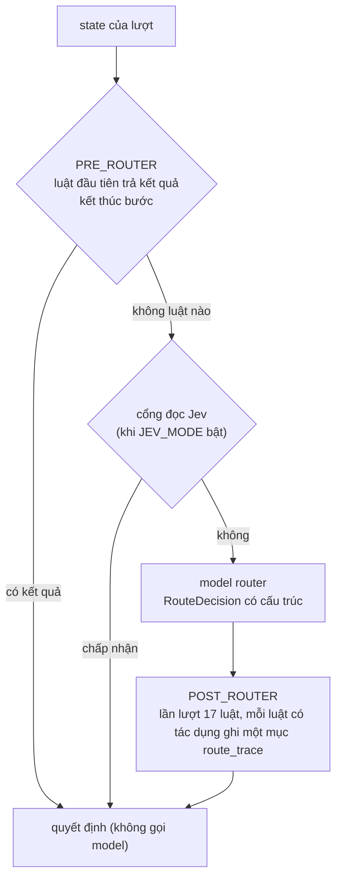
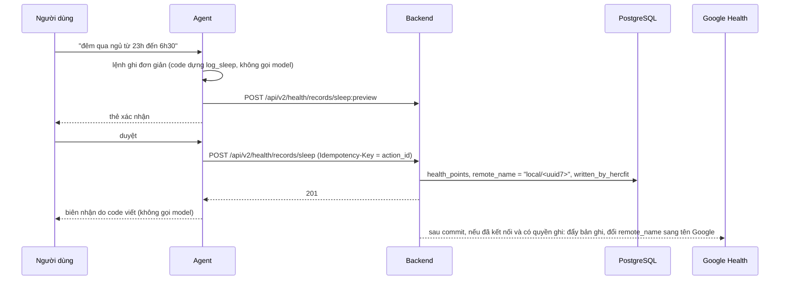

# Kiến trúc HercFit

HercFit là trợ lý AI về dinh dưỡng, tập luyện và sức khoẻ. Hệ thống gồm một backend nghiệp vụ, một service agent
(LangGraph, multi-agent), một worker chiếu Knowledge Graph và một SPA Vue. Tài liệu này mô tả đúng mã nguồn ở nhánh
hiện tại; mỗi mục ghi file để kiểm lại.

## 1. Thành phần khi chạy

- Agent không đọc bảng nghiệp vụ trực tiếp. Nó đọc và ghi qua API backend bằng token uỷ quyền ngắn hạn
  (`POST /api/v2/auth/delegations`, ký HMAC bằng `AGENT_SERVICE_SECRET`). Database chỉ dùng cho bảng của chính nó, bằng role
  tối thiểu `hercfit_agent` (`backend/scripts/db_roles.sql`, `backend/docker-compose.yml`).
- Bản dev chạy các vòng nền trong API. Bản prod (`backend/docker-compose.prod.yml`) tắt chúng trong API và chạy
  `worker.py`. Vòng LISTEN WebSocket và vòng ghi số đo route luôn ở API, vì chúng phục vụ kết nối và bộ đếm của chính
  tiến trình đó (`backend/app.py`, `backend/worker.py`).
- Dữ liệu gửi ra dịch vụ ngoài và phần đã che: `docs/DATA_FLOW.md`.

## 2. Kiến trúc multi-agent

Một supervisor phân loại yêu cầu một lần, rồi giao cho **agent chuyên trách sở hữu miền** của quyết định
(`backend/agentic/core/roster.py`, `backend/agentic/agents/specialists.py`).

| Agent | Miền sở hữu | Luật riêng của agent |
|---|---|---|
| `nutrition` | meals, foods | dựng bữa ăn bằng code từ bản nháp của router; tiếp nối bữa kế tiếp (`meal_log_next`); gợi ý món luôn tra catalog |
| `training_log` | trainings, exercises | hỏi cách ghi buổi gym trước (`gym_mode_guard`); tiếp nối theo lựa chọn chi tiết/nhanh |
| `body_health` | metrics, progress, profile | — |
| `coach` | training_plans, goals, coaching | dựng lịch tập sau khi chế độ Plan đã tra cứu nguyên tắc (`plan_build_tool`) |
| `daily_health` | health | chỉ đọc đánh giá do backend tính |

Ngoài ra còn các agent theo vai trò: `supervisor` (router), `research`, `synthesizer` (câu trả lời), `context` (Context
Agent viết Cypher), `clarify`, `memory`, `notifier`.

- **Model riêng:** mỗi agent có thể dùng model riêng qua `AGENT_MODELS`; agent đang chạy được đặt theo node
  (`roster.acting`, `roster.assigned_model`).
- **Dùng chung:** mọi agent chuyên trách kế thừa `ToolAgent`, nên dùng chung danh sách tool cho phép theo miền
  (`tools/policy.py`), bản xem trước, cổng xác nhận HITL và nhật ký thực thi. Quyền đọc/ghi không phụ thuộc agent nào
  thực hiện.
- **Tool:** 71 tool, 31 tool ghi (`tools/registry.py`). Mọi lệnh ghi đi qua bản xem trước và thẻ xác nhận trước khi
  thực thi.

## 3. Workflow LangGraph

Nguồn: `backend/agentic/agents/workflow.py` (`after_orchestrator`, `after_specialist`, `after_research`,
`after_confirmation`).

### 3.1. Một bước định tuyến

`OrchestrationAgent.decide` (`backend/agentic/agents/orchestration_agent.py`) chạy theo thứ tự cố định. Mọi luật nằm trong
`backend/agentic/services/route_rules.py`.

| Danh sách | Thứ tự |
|---|---|
| `PRE_ROUTER` (13) | đọc nhanh theo mẫu · lệnh ghi đơn giản · gợi ý món · trạng thái hỏi lại/thất bại · ngân sách tool · chặn an toàn · trả lời thẻ chọn bản ghi · trả lời thẻ món thiếu · lần đọc chỉ-đọc gặp handoff · handoff tra catalog · handoff tra cứu bài tập · luật tiếp nối của agent chuyên trách · `write_done` (biên nhận do code viết) |
| `POST_ROUTER` (17) | `primary_task_domain` · giữ quyền chỉ-đọc · `clarify_to_catalog_lookup` · `clarify_known_facts` · `plan_deep`/`personalize` · `chat_to_knowledge` · `training_read_first` · `plan_catalog_only` · `tool_next_agent` · chốt tuyến tool có miền · `knowledge_to_research` · `food_gap_card`/`food_research_to_catalog` · kiểm lại quyền chỉ-đọc · gợi ý món phải tra catalog · `plan_mode_only` · luật nhận việc của agent (`gym_mode_guard`) · `fan_out` |

Mỗi luật có ca kích hoạt và ca không kích hoạt trong bộ eval tất định (`tests/evaluation/README.md`).

### 3.2. Chế độ trò chuyện

`backend/agentic/services/mode.py`:
- **normal:** ghi nhận và xem nhanh; không tra cứu tri thức, không thẻ hồ sơ; câu tư vấn được mời sang Plan.
- **plan:** luôn đọc dữ liệu người dùng rồi tra cứu nguồn đã kiểm chứng; không có lối tắt.

## 4. Đường ghi: HercFit là nguồn sự thật

- Bản ghi người dùng tự nhập (buổi thể thao, cân nặng, chiều cao, % mỡ, nước, giấc ngủ) lưu cục bộ trước, không cần kết
  nối Google và không gọi mạng trong transaction (`integrations/google_health/records.py`).
- Job đẩy được xếp sau commit (`schedule_push` trong `integrations/google_health/directory.py`, `push.py`). Lần đồng bộ
  sau nhận ra bản đã đẩy và không tạo trùng (`pull.py`).
- Bữa ăn, buổi tập gym, mục tiêu, lịch tập là bảng nghiệp vụ của HercFit. Mọi lệnh ghi nghiệp vụ idempotent theo
  `Idempotency-Key` (`core/idempotency.py`).

## 5. Ngữ cảnh cá nhân và tri thức

| Nguồn | Khi nào | Mã nguồn |
|---|---|---|
| Thẻ hồ sơ (`card`) | một lần mỗi lượt, khi chế độ cho phép (không có ở chế độ thường) | `services/personal_context.py` (`load_card`), `workflow.decide_step` |
| Sự kiện KG kiểu cũ (`kg_facts`) | theo miền của quyết định | `services/rag_pipeline.py` (`retrieve_graph_context`) |
| Context graph (`context_graph`) | quyết định có `context` | `workflow.context_graph_step`, `knowledge_graph/context/` |
| Lần đọc backend của nút context (`backend_reads`) | yêu cầu cá nhân hoá | `workflow.context_step`, `personal_context.deep_reads` |
| Tri thức đã kiểm chứng | câu hỏi kiến thức, tư vấn ở chế độ Plan | `agents/research_agent.py`: cơ sở tri thức (hybrid search ở backend) rồi web (Tavily) |

Bốn nguồn đầu bật/tắt được qua `CONTEXT_SOURCES` (`personal_context.sources`), chỉ để chạy thí nghiệm E5.

## 6. Đánh giá và quan sát

- `make -C tests check`: lint, test đơn vị và tích hợp, eval tất định (graph thật, model kịch bản, backend giả), eval an
  toàn, an toàn Cypher. CI: `.github/workflows/quality.yml`.
- Kết quả thí nghiệm của khoá luận: `docs/EVALUATION.md`, `docs/evaluation/`.
- Truy vết: Langfuse qua `agentic/observability/` (che dữ liệu nhạy cảm trước khi gửi, xem `docs/DATA_FLOW.md`).
